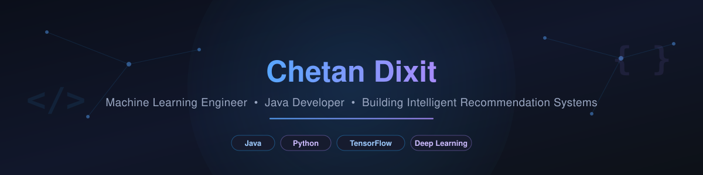

 

### Aspiring AI/ML Engineer

**I build practical intelligent systems with Machine Learning, Deep Learning, NLP and Generative AI — from raw data to a working application.**

 

 

<a href="#about">About</a> •
<a href="#technical-skills">Skills</a> •
<a href="#featured-projects">Projects</a> •
<a href="#currently-learning">Learning</a> •
<a href="#github-activity">Activity</a> •
<a href="#dsa-and-leetcode">DSA</a> •
<a href="#achievements-and-certifications">Achievements</a> •
<a href="#connect">Connect</a>

---

## About

I'm a B.Tech Computer Science Engineering student specializing in **AI & ML**, focused on building end-to-end projects rather than stopping at coursework. My work so far spans OCR pipelines, LLM-powered analysis, NLP classification, recommender systems and classical ML on tabular data.

- 🤖 Interested in **Machine Learning, Deep Learning, NLP and Generative AI**
- 💻 Primary languages: **Python** and **Java**
- 🧩 Practicing **Data Structures & Algorithms in Java**
- 🛠️ Building **practical, end-to-end AI/ML projects** — data, modeling, evaluation and a usable interface
- 🎯 Seeking **Machine Learning / Software Engineering internships**

---

## Technical Skills

<!-- Maintenance: move a technology from "Actively learning" to its category once it has been used in a real project. -->

| Category | Hands-on experience |
|:--|:--|
| **Languages** |    |
| **Machine Learning & Data Science** |       |
| **AI & Generative AI** |     |
| **Tools & Platforms** |       |
| **Web Fundamentals** |    |
| **Actively learning** |      |

---

## Featured Projects

| Project | Domain | Key result | Status |
|:--|:--|:--|:--:|
| [AANCHAL](#1-aanchal) | OCR · LLMs · LangChain | OCR + LLM pipeline working; RAG chatbot in development | 🚧 In progress |
| [Customer Support NLP](#2-customer-support-nlp) | NLP · Text classification | ≈ 87.69% accuracy on 77 intents | ✅ Completed |
| [Movie Recommender System](#3-movie-recommender-system) | Deep learning · Recommenders | Test MAE 0.1378 · RMSE 0.1743 | ✅ Completed |
| [Heart Failure Prediction](#4-heart-failure-prediction) | Classical ML · Tabular data | Best CV ROC-AUC ≈ 0.9327 | ✅ Completed |

<!-- Maintenance: copy one project block below to add a new project, and add a matching row to the table above. -->

### 1. AANCHAL

**AI-Assisted Nutrition & Child Health Awareness Layer** · 🚧 *Ongoing project*

An AI-powered child nutrition awareness application designed for the **Anganwadi community**. It reads nutrition labels from images and uses an LLM to turn the extracted data into clear nutrition analysis.

| | |
|:--|:--|
| **Implemented** | • OCR-based nutrition label extraction • Image preprocessing and text recognition • Nutrition information extraction • LLM-powered nutrition analysis using Groq • LangChain prompt engineering • OCR confidence scoring and manual review indicators |
| **In development** | • Nutrition awareness chatbot • Retrieval-Augmented Generation (RAG) • Verified nutrition knowledge retrieval |
| **Tech stack** |       |

<!-- TODO: add repository link for AANCHAL once it is public, e.g. 🔗 **Repository:** [github.com/ChetanDixit-0717/<repo-name>](...) -->

---

### 2. Customer Support NLP

An NLP intent classification project for customer support queries using the **Banking77** dataset.

| | |
|:--|:--|
| **Dataset** | Banking77 · 77 intent classes |
| **Approach** | TF-IDF feature extraction · Logistic Regression / linear classifier experimentation |
| **Result** | ≈ **87.69%** classification accuracy |
| **Tech stack** |      |

<!-- TODO: add repository link for Customer Support NLP. -->

---

### 3. Movie Recommender System

A deep learning recommendation engine built on a **Two-Tower neural network** that learns separate user and movie embeddings for personalized recommendations.

<!-- 📸 Optional: add an architecture diagram here (user tower / movie tower / similarity scoring). -->

| | |
|:--|:--|
| **Dataset** | MovieLens 1M |
| **Approach** | Separate user and movie embedding towers · learned user/item representations · similarity-based ranking |
| **Performance** | Test MAE: `0.1378` · Test RMSE: `0.1743` |
| **Tech stack** |     |

🔗 **Repository:** [github.com/ChetanDixit-0717/two-tower-movie-recommender](https://github.com/ChetanDixit-0717/two-tower-movie-recommender)

---

### 4. Heart Failure Prediction

A machine learning classification project with a full scikit-learn workflow, from preprocessing to tuned model comparison.

| | |
|:--|:--|
| **Models** | Random Forest · XGBoost |
| **Workflow** | Scikit-learn pipelines · ColumnTransformer preprocessing · cross-validation · hyperparameter tuning |
| **Result** | Best cross-validation ROC-AUC ≈ **0.9327** |
| **Tech stack** |     |

<!-- TODO: add repository link for Heart Failure Prediction. -->

---

### Other Projects

| Project | Description | Tech | Repository |
|:--|:--|:--|:--|
| **Handwritten Digit Recognizer** | ANN classifier for MNIST with accuracy/loss visualization |   | [digit-recognizer](https://github.com/ChetanDixit-0717/digit-recognizer) |
| **Student Management System (CLI)** | Command-line app with full CRUD, OOP structure and JSON file persistence |  | [student-management-system-cli](https://github.com/ChetanDixit-0717/student-management-system-cli) |

---

## Currently Learning

- 🧠 **Deep Learning** — going beyond baseline architectures
- 💬 **Natural Language Processing** — from TF-IDF baselines toward modern LLM-based approaches
- 🔗 **LLM application development** — LangChain, prompt engineering, Groq API
- 📚 **Retrieval-Augmented Generation (RAG)** — being applied in AANCHAL
- 🔍 **OCR-based AI applications** — preprocessing, confidence scoring, human-in-the-loop review
- 🧩 **Data Structures & Algorithms in Java** — daily practice on LeetCode
- ⚙️ **Backend & deployment basics** — FastAPI, SQL, MongoDB, Docker

---

## DSA and LeetCode

---

## Achievements and Certifications

**Highlights**

- 🏆 Solved **150+ DSA problems** on LeetCode and earned the **100 Days Badge 2026**
- 🚀 Built multiple **end-to-end machine learning and deep learning projects** spanning OCR, NLP, recommender systems and tabular ML
- 🌱 Actively extending into LLM applications (LangChain, RAG) and backend skills (FastAPI, SQL, MongoDB)

**Certifications**

| Certification | Issuer | Status |
|:--|:--|:--:|
| Machine Learning Specialization (Andrew Ng) | DeepLearning.AI / Coursera | ✅ Completed |
| [Pandas](https://www.kaggle.com/learn/certification/chetan0717/pandas) | Kaggle | ✅ Completed |

<!-- TODO: add a credential link for the Machine Learning Specialization if you have one. -->

---

## Connect

<!-- TODO: add your LinkedIn badge once you have the real profile URL:
 -->

Open to Machine Learning / Software Engineering internships.

---

